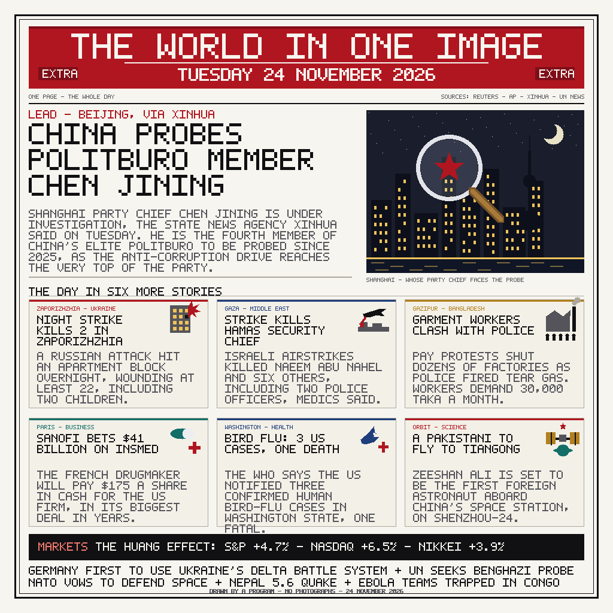

# the-world-in-one-image-20261124

[](https://make.fun/bounty/news-image-20261124?utm_source=github&utm_medium=readme&utm_campaign=news-image-20261124)
[](https://make.fun/bounty/news-image-20261124/leaderboard?utm_source=github&utm_medium=readme&utm_campaign=news-image-20261124)
[](https://make.fun/bounty/news-image-20261124?utm_source=github&utm_medium=readme&utm_campaign=news-image-20261124)



## About this entry

A single Node program (`main.ts`, standard library only — no packages, no
assets, no network) draws an entire newspaper front page in software and
writes it as one deterministic 1024×1024 PNG. The program contains its own
rasterizer (rectangles, lines, circles, ellipses, polygons, stars), a
hand-authored 5×7 bitmap font with word-wrap layout, drawn illustrations
(a Shanghai skyline under a magnifier for the lead story, and one pictogram
per panel), and its own PNG encoder. Running it twice produces
byte-identical output.

The design is a classic "extra edition" sheet: white page, black type, a
red masthead, one lead story across the top, six story panels, a black
markets band, and a two-line wire ticker along the bottom — deliberately
different from this account's cream broadsheet of 21 November and its navy
night poster of 22 November.

## The day's stories — Tuesday 24 November 2026

- **Lead — Beijing:** China probes Politburo member Chen Jining. Shanghai's
  party chief is under investigation, Xinhua said on Tuesday — the fourth
  member of China's elite Politburo to be probed since 2025.
- **Zaporizhzhia, Ukraine:** A Russian attack hit an apartment block
  overnight, killing 2 and wounding at least 22, including two children.
- **Gaza:** Israeli airstrikes killed Naeem Abu Nahel, director of Hamas'
  internal security apparatus, and six others, including two police
  officers.
- **Gazipur, Bangladesh:** Garment workers clashed with police as pay
  protests shut dozens of factories; workers demand the minimum wage more
  than double to 30,000 taka a month.
- **Business:** Sanofi will buy US drugmaker Insmed for $41 billion in
  cash, $175 a share.
- **Health:** The WHO said the US notified three confirmed human bird-flu
  cases in Washington state, including one death.
- **Space:** Pakistan's Zeeshan Ali is set to become the first foreign
  astronaut aboard China's Tiangong space station, on Shenzhou-24.
- **Markets:** The Huang effect — as Nvidia's founder returns, the S&P 500
  rose 4.7%, the Nasdaq 6.5% and the Nikkei 3.9%.
- **Ticker:** Germany first to use Ukraine's Delta battle system · the UN
  seeks a probe of the Benghazi port strike · NATO vows to defend space ·
  a 5.6 quake in Nepal · Ebola teams trapped by fighting in Congo's Ituri.

## Run it

```sh
mkdir -p out && MAKEFUN_OUTPUT_DIR=out node main.ts
# writes out/entry.png — 1024×1024, byte-identical on every run
```

## License

MIT — see [LICENSE](LICENSE). Sources and per-story fact notes are in
[NOTES.md](NOTES.md).
